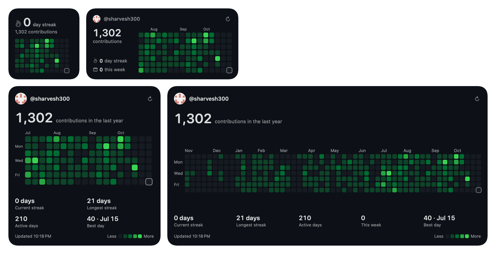
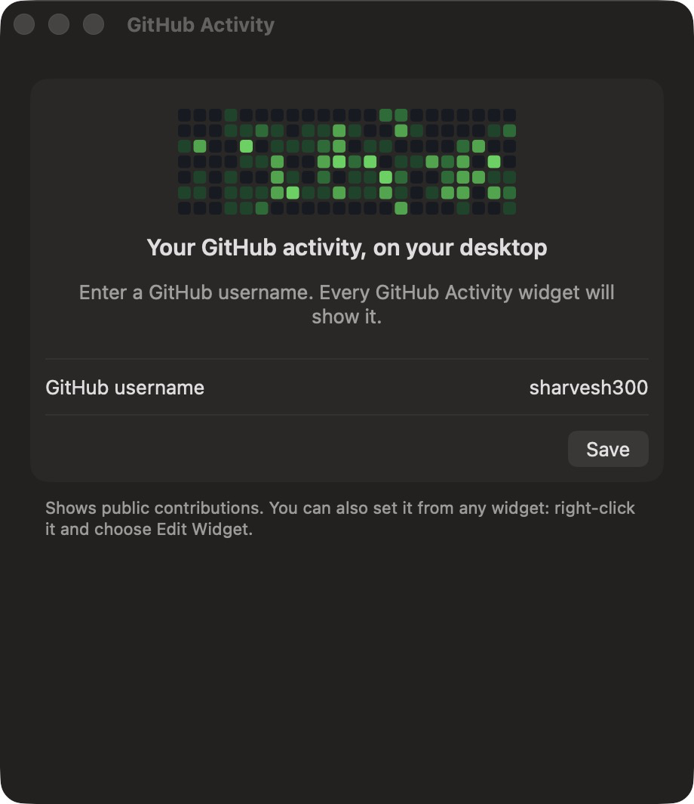
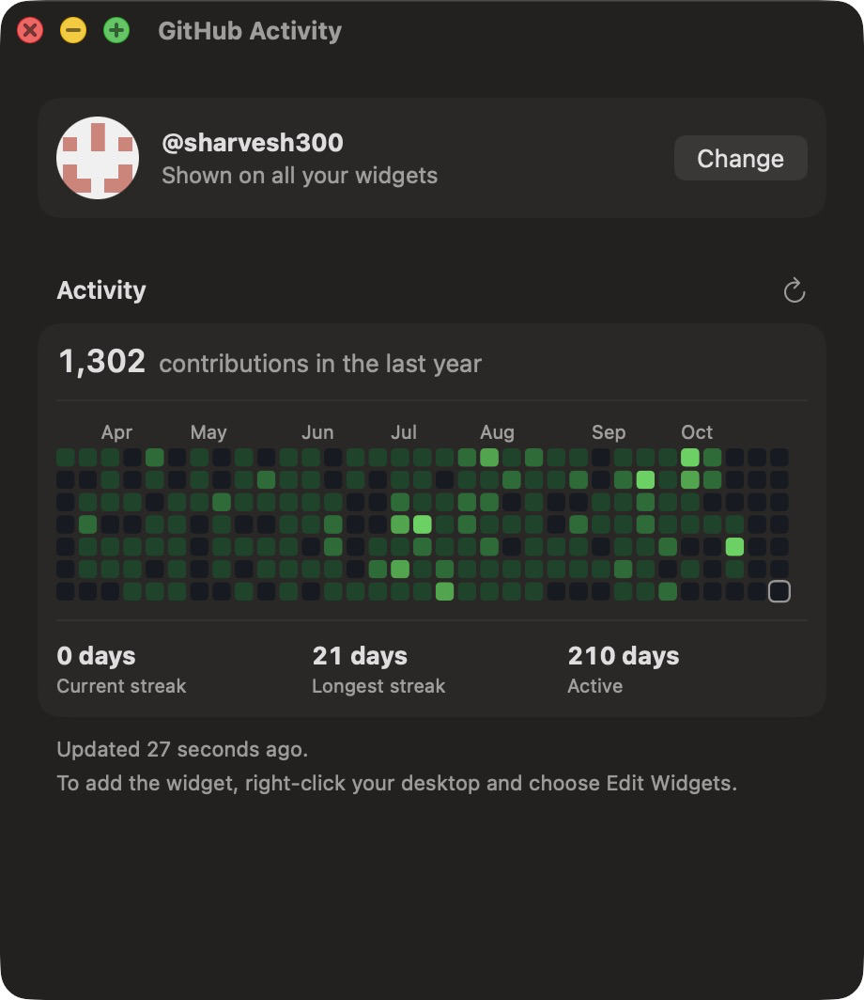
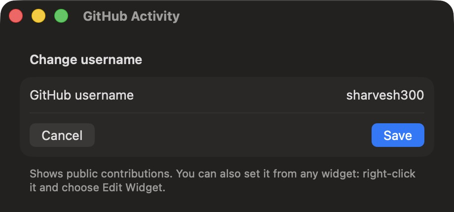
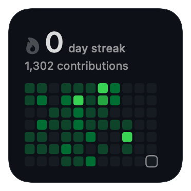
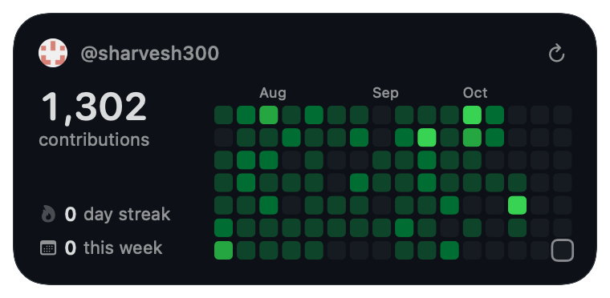
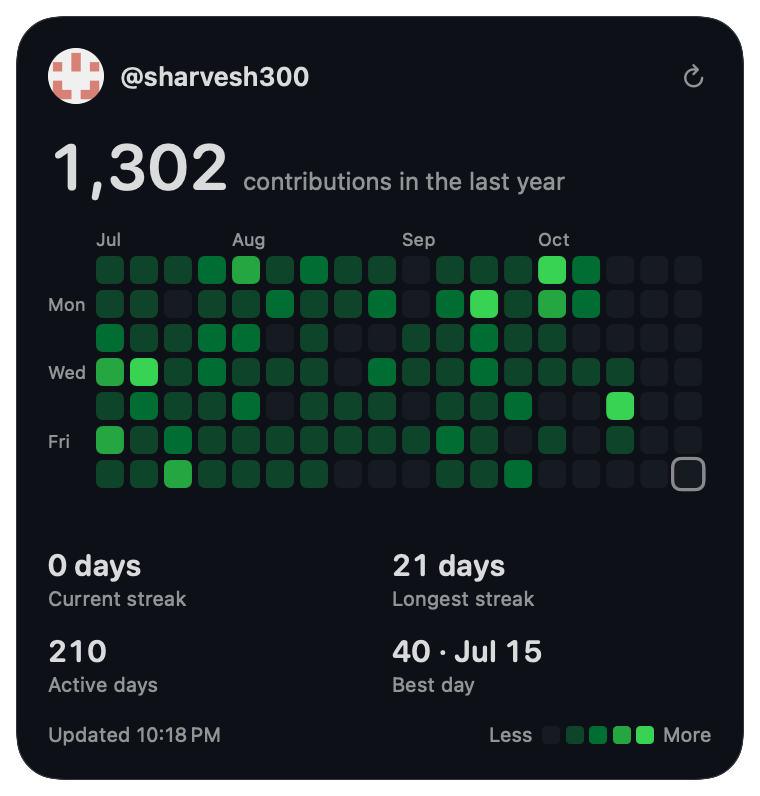
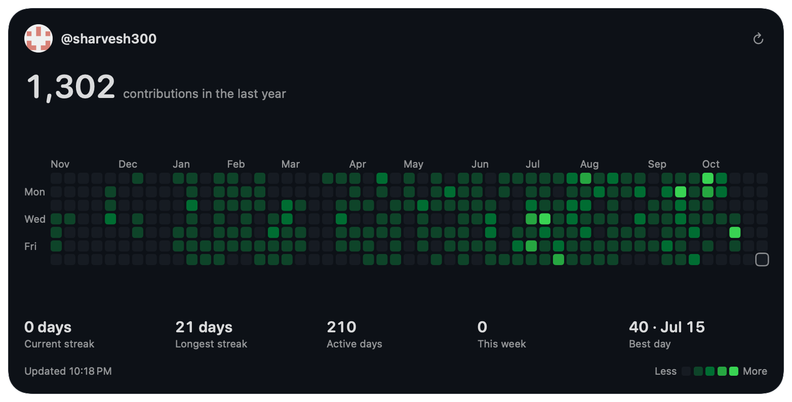
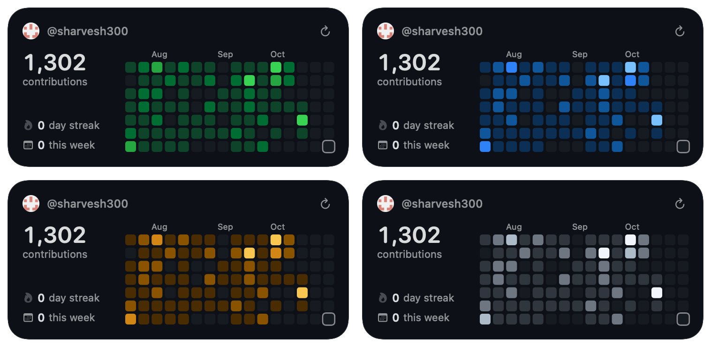
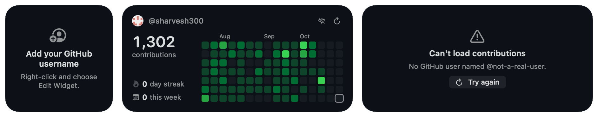

# GitHub Activity

**Your GitHub contribution graph, live on your Mac's desktop.**

GitHub Activity is a free macOS app with desktop widgets that show anyone's GitHub contribution graph, streaks and stats, just like the graph on a GitHub profile. Type a GitHub username once and every widget keeps itself up to date.

<p align="center">
  <picture>
    <source media="(prefers-color-scheme: dark)" srcset="docs/images/widgets-dark.png">
    <source media="(prefers-color-scheme: light)" srcset="docs/images/widgets-light.png">
    
  </picture>
</p>

<p align="center">
  macOS 14 Sonoma or later · Apple silicon and Intel · No sign-in needed
</p>

---

## Contents

1. [Features](#features)
2. [Requirements](#requirements)
3. [Install](#install)
4. [Set up, step by step](#set-up-step-by-step)
5. [Widget sizes](#widget-sizes)
6. [Themes](#themes)
7. [What the widget shows](#what-the-widget-shows)
8. [Updates, refresh and offline](#updates-refresh-and-offline)
9. [Troubleshooting](#troubleshooting)
10. [Privacy](#privacy)
11. [Uninstall](#uninstall)
12. [For developers](#for-developers)

---

## Features

- **The real contribution graph.** The same squares, colours and month labels as a GitHub profile, with today's square outlined.
- **Four sizes.** From a small streak counter to the full year on an extra-large widget.
- **Streaks and stats.** Current streak, longest streak, active days, this week and best day.
- **Four themes.** GitHub, Ocean, Amber and Mono, each with a light and dark version that follows your Mac's appearance.
- **One username for every widget.** Set it in the app or in any widget, and all your widgets show it until you change it.
- **Keeps itself up to date.** Refreshes about every 30 minutes, with a ↻ button for an instant update.
- **Works offline.** If GitHub can't be reached, the widget keeps showing the last data it had.
- **Private by design.** No account, no token, no tracking. It only talks to github.com.

## Requirements

| You need | Details |
|---|---|
| A Mac | macOS 14 Sonoma or later, Apple silicon or Intel |
| An internet connection | To fetch contributions from github.com |
| A GitHub username | Yours or anyone else's. Only **public** contributions are shown |

You don't need a GitHub account sign-in, a password or an access token.

## Install

1. Download the latest **`GitHubActivity-<version>.dmg`** from the [Releases page](../../releases/latest).
2. Open the downloaded `.dmg`.
3. Drag **GitHubActivity** onto the **Applications** folder shown next to it.
4. Eject the disk image (click ⏏ next to "GitHub Activity" in Finder's sidebar).
5. Open **GitHub Activity** from your Applications folder, Launchpad or Spotlight (<kbd>⌘</kbd> <kbd>Space</kbd>, then type "GitHub Activity").

> [!NOTE]
> **If macOS says the app "can't be opened" or "can't be verified":** you have a build that isn't notarized by Apple yet. You can still open it:
> - **macOS 15 Sequoia and later:** try to open the app once, then go to **System Settings › Privacy & Security**, scroll down, click **Open Anyway** next to the message about GitHub Activity, and confirm.
> - **macOS 14 Sonoma:** Control-click the app in Applications, choose **Open**, then click **Open** again.
>
> You only need to do this once.

## Set up, step by step

### Step 1: Enter a GitHub username

When you open the app for the first time, it asks for a GitHub username.

<p align="center">
  
</p>

1. Click the **GitHub username** field.
2. Type a username, for example `sharvesh300`. You can also paste `@sharvesh300` or a profile link like `https://github.com/sharvesh300`.
3. Click **Save** or press <kbd>Return</kbd>.

### Step 2: Check the preview

The app loads that person's contributions and shows a preview of what the widget will show.

<p align="center">
  
</p>

> [!TIP]
> The very first load can take up to a minute, because GitHub is sometimes slow to build the contributions page. After that it's usually a few seconds.

### Step 3: Add the widget to your desktop

1. Go to your desktop and **right-click** (or Control-click) an empty area.
2. Choose **Edit Widgets…**
3. In the widget gallery, search for **GitHub Activity**.
4. Pick a size (small, medium, large or extra large) and **drag it onto your desktop**, or click it to add it.
5. Click **Done**.

The widget shows the username you saved in Step 1 straight away. You can add as many widgets as you like, in any sizes.

> [!TIP]
> You can also put the widget in **Notification Center**: click the date and time in the menu bar, scroll to the bottom and click **Edit Widgets…**

### Step 4: Choose a theme

1. **Right-click** the widget and choose **Edit "GitHub Activity"**.
2. Pick a **Theme**: GitHub, Ocean, Amber or Mono.
3. Click outside the panel to close it.

Each widget can have its own theme, so you could have a green one and a blue one side by side.

### Step 5: Change the username later

The username is shared by **all** your GitHub Activity widgets and the app, and it stays saved until you change it. You can change it in either place:

**In the app:** open GitHub Activity, click **Change**, edit the name and click **Save**.

<p align="center">
  
</p>

**From any widget:** right-click it, choose **Edit "GitHub Activity"**, type the new name in **GitHub username** and close the panel.

Either way, every widget switches to the new person within a few seconds.

## Widget sizes

### Small: your streak at a glance



The current streak in large type with a flame (grey when the streak is 0), the total number of contributions, and the last couple of months of the graph.

### Medium: totals and recent months



The username and avatar, the total, the current streak and this week's contributions, next to about four months of the graph with month labels and a ↻ refresh button.

### Large: the graph with labels and key stats



The total, about five months of the graph with month and weekday labels, current streak, longest streak, active days and best day, plus the update time and colour legend.

### Extra large: the whole year



The full year, exactly like a GitHub profile, with all five stats underneath.

## Themes

<p align="center">
  <picture>
    <source media="(prefers-color-scheme: dark)" srcset="docs/images/themes-dark.png">
    <source media="(prefers-color-scheme: light)" srcset="docs/images/themes-light.png">
    
  </picture>
</p>

| Theme | Colours |
|---|---|
| **GitHub** (default) | The familiar GitHub greens |
| **Ocean** | Blues |
| **Amber** | Warm yellows and oranges |
| **Mono** | Greys, for a minimal desktop |

Every theme has a dark and a light version and follows your Mac's appearance (System Settings › Appearance).

When windows cover your desktop, macOS shows widgets in a dimmed, single-colour style. GitHub Activity switches to shades of one colour then, so the graph stays readable. You can control this under **System Settings › Desktop & Dock › Widgets**.

## What the widget shows

| Item | Meaning |
|---|---|
| **Contributions in the last year** | The same total as the person's GitHub profile |
| **Squares** | One per day, grouped into weeks (Sunday to Saturday). Darker or brighter means more contributions, using GitHub's five levels |
| **Outlined square** | Today |
| **Current streak** | Days in a row with at least one contribution, up to today. If there's nothing yet *today*, it counts up to yesterday, so the streak isn't broken until the day is over |
| **Longest streak** | The longest run of days in a row within the last year |
| **Active days** | Days in the last year with at least one contribution |
| **This week** | Contributions since Sunday |
| **Best day** | The day with the most contributions, and how many |

## Updates, refresh and offline

- **Automatic updates:** each widget refreshes about every **30 minutes**. macOS decides the exact timing, so updates can come later, for example while your Mac is asleep.
- **Refresh now:** click **↻** in the top-right corner (medium, large and extra-large widgets).
- **Open the profile:** click anywhere else on the widget to open the GitHub profile in your browser.
- **Offline:** if GitHub can't be reached, the widget keeps showing the last data it had, with a small 📶 offline icon and "Offline · updated … ago". It tries again about every 10 minutes.

### Messages you might see

<p align="center">
  
</p>

| Message | What to do |
|---|---|
| **Add your GitHub username** | No username has been saved yet. Follow [Step 1](#step-1-enter-a-github-username), or right-click the widget and choose **Edit "GitHub Activity"** |
| 📶 **Offline icon** | GitHub couldn't be reached, so you're seeing the last saved data. It updates by itself when the connection is back |
| **Can't load contributions** | Read the reason under the title, for example a username that doesn't exist. Fix it, then click **Try again** |

## Troubleshooting

<details>
<summary><b>GitHub Activity isn't in the widget gallery</b></summary>

1. Make sure the app is in your **Applications** folder (not running from the disk image).
2. Open the app once. macOS registers its widgets the first time it runs.
3. Close and reopen **Edit Widgets…**, then search again.
4. If it's still missing, log out and back in, or restart your Mac.
</details>

<details>
<summary><b>"Couldn't reach GitHub. The connection kept dropping."</b></summary>

Something between your Mac and GitHub is interrupting the secure connection. This is usually a **VPN or firewall**, for example Cloudflare WARP. The app already retries automatically. If you see this often, pause the VPN, or exclude `github.com` from it (for example in WARP's split-tunnel settings), then click ↻.
</details>

<details>
<summary><b>"GitHub took too long to respond."</b></summary>

GitHub's contributions page can be slow, especially on the first request. Wait a moment and click ↻. If you use a VPN, try without it.
</details>

<details>
<summary><b>The numbers don't match my GitHub profile</b></summary>

- GitHub can take a few minutes to update its graph after you push. Click ↻ a little later.
- The widget shows **public** contributions only. Private work appears only if you've turned on **"Include private contributions on my profile"** in your GitHub profile settings, and then only as anonymous counts.
- Days follow GitHub's calendar, so "today" can roll over at a slightly different time than your clock.
</details>

<details>
<summary><b>The widget isn't updating</b></summary>

Click **↻**. macOS limits how often widgets can refresh, so automatic updates can be delayed, especially on battery or after waking from sleep. Opening the app also refreshes the data, and every widget with it, if it's more than 10 minutes old.
</details>

<details>
<summary><b>The app "can't be opened" or "can't be verified"</b></summary>

See the note in [Install](#install). You only have to allow it once.
</details>

## Privacy

- **No account, no sign-in, no analytics, no tracking.**
- The app talks only to GitHub:
  - `https://github.com/users/<username>/contributions`, the public contributions page.
  - `https://github.com/<username>.png`, the public avatar.
- The username, the last downloaded data and the avatar are stored **only on your Mac**, in the app's own storage.

## Uninstall

1. Remove the widgets: right-click each one and choose **Remove Widget**.
2. Quit GitHub Activity, then drag it from **Applications** to the **Trash**.
3. *Optional:* to also delete the saved username and data, open Finder, choose **Go › Go to Folder…** (<kbd>⇧</kbd> <kbd>⌘</kbd> <kbd>G</kbd>), enter `~/Library/Group Containers`, and move any folder whose name contains `com.sharvesh300.GitHubActivity` to the Trash.

---

## For developers

### Build and run from source

**You need:** a Mac with macOS 14 or later and **Xcode 27 or later**. The project uses Xcode 27's project format.

```bash
git clone https://github.com/sharvesh300/github_contribution_widget.git
cd github_contribution_widget
open github_contribution_widget.xcodeproj
```

In Xcode, choose the **GitHubActivity** scheme and **My Mac**, then press <kbd>⌘</kbd> <kbd>R</kbd>. To sign with your own team, select both the **GitHubActivity** and **GitHubActivityWidget** targets and choose your team under **Signing & Capabilities**.

Run the tests (<kbd>⌘</kbd> <kbd>U</kbd> in Xcode, or from Terminal):

```bash
xcodebuild test -scheme GitHubActivity -destination 'platform=macOS' CODE_SIGN_IDENTITY=- CODE_SIGN_STYLE=Manual
```

### Build the DMG

```bash
scripts/build-dmg.sh
```

This builds a Release version for Apple silicon and Intel and creates `build/GitHubActivity-<version>.dmg`, containing the app and an Applications shortcut. On its own it signs ad hoc, which is fine for testing on your Mac.

To make a DMG that opens on **any Mac without warnings**, you need an [Apple Developer Program](https://developer.apple.com/programs/) membership and a **Developer ID Application** certificate. Store your notarization credentials once:

```bash
xcrun notarytool store-credentials github-activity --apple-id you@example.com --team-id ABCDE12345 --password <app-specific-password>
```

Then build, sign and notarize in one go:

```bash
DEVELOPMENT_TEAM=ABCDE12345 SIGN_IDENTITY="Developer ID Application: Your Name (ABCDE12345)" NOTARY_PROFILE=github-activity scripts/build-dmg.sh
```

Check that Gatekeeper accepts it (you should see `source=Notarized Developer ID`):

```bash
spctl -a -vvv -t install build/GitHubActivity-1.0.dmg
```

### Project structure

```
github_contribution_widget/
├── App/                     The macOS app (settings window)
│   ├── GitHubActivityApp.swift
│   ├── SettingsView.swift   Username entry, preview, change username
│   ├── AccountModel.swift   Shared username, refresh logic
│   └── GitHubSignIn.swift   GitHub sign-in (device flow); kept, not offered yet
├── Widget/                  The WidgetKit extension
│   ├── ContributionWidget.swift   Timeline provider, entry, widget declaration
│   ├── WidgetViews.swift          Small, medium, large and extra-large layouts
│   └── WidgetIntents.swift        Edit Widget options and the ↻ refresh button
├── Shared/                  Compiled into both the app and the widget
│   ├── ContributionModels.swift   Days, weeks, streaks and stats
│   ├── GitHubService.swift        Fetching and parsing GitHub data, with retries
│   ├── ContributionStore.swift    Shared username, cache, avatars
│   ├── ContributionGrid.swift     The heatmap view and legend
│   └── Theme.swift                Colour themes
├── Tests/                   Unit tests (Swift Testing)
├── Config/                  Info.plists and entitlements
├── scripts/build-dmg.sh     Release build and DMG packaging
└── docs/images/             Screenshots used in this README
```

### How it works

- **App and widget:** the app embeds the widget extension. They share the username and the cached data through an **App Group**, so a username saved in one shows up in the other.
- **Timeline:** macOS's WidgetKit asks the widget for a new timeline about every 30 minutes. The widget fetches the public contributions page, parses it into days and weeks, saves the result, and returns a single snapshot that macOS draws on the desktop.
- **Refresh button:** the ↻ button runs an App Intent that fetches fresh data. WidgetKit then reloads the timeline, which reuses that data instead of fetching twice.
- **Shared username:** a username typed into any widget's Edit Widget panel becomes the shared username, because the widget remembers which entries it has already seen and only applies a new one. Older entries left in other widgets never switch it back.
